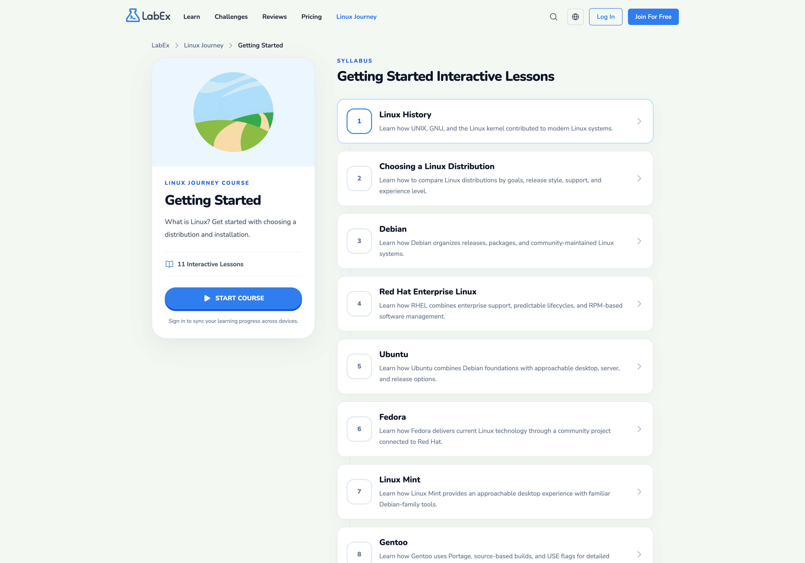

# Linux Journey

Learn Linux, DevOps, and cybersecurity through interactive lessons.

  <a href="https://labex.io/linuxjourney"><strong>Learn on LabEx</strong></a>
  · <a href="#learning-paths">Browse learning paths</a>

  

  
  
  
  

> [!NOTE]
> Linux Journey has [joined the LabEx](https://support.labex.io/en/using-labex/linux-journey-now-part-of-labex) and is now actively maintained by the LabEx team while remaining free and open source.
>
> We will continue building more structured Linux learning content and hands-on labs for beginners.
>
> Official website: https://labex.io/linuxjourney (formerly https://linuxjourney.com)

## Learning paths

| Path | What you'll learn |
| --- | --- |
| [Grasshopper](#grasshopper) | Linux fundamentals, from the command line to package management |
| [Journeyman](#journeyman) | Devices, filesystems, boot, and other system internals |
| [Networking Nomad](#networking-nomad) | Network administration, routing, and troubleshooting |
| [DevOps](#devops) | Build, deploy, and troubleshoot services |
| [Cybersecurity](#cybersecurity) | Protect systems and interpret security evidence |

## Grasshopper

### Getting Started

What is Linux? Get started with choosing a distribution and installation.

[Watch on YouTube](https://www.youtube.com/watch?v=hYZIoIVrPKg)

- [Linux History](https://labex.io/lesson/linux-history)
- [Choosing a Linux Distribution](https://labex.io/lesson/choosing-a-linux-distribution)
- [Debian](https://labex.io/lesson/debian)
- [Red Hat Enterprise Linux](https://labex.io/lesson/red-hat-enterprise-linux)
- [Ubuntu](https://labex.io/lesson/ubuntu)
- [Fedora](https://labex.io/lesson/fedora)
- [Linux Mint](https://labex.io/lesson/linux-mint)
- [Gentoo](https://labex.io/lesson/gentoo)
- [Arch Linux](https://labex.io/lesson/arch-linux)
- [openSUSE](https://labex.io/lesson/opensuse)
- [Best Linux for Cybersecurity](https://labex.io/lesson/best-linux-distro-for-cybersecurity)

### Command Line

Learn the fundamentals of the command line, navigating files, directories, and more.

[Watch on YouTube](https://www.youtube.com/watch?v=AW6VmoHoVTU)

- [The Shell](https://labex.io/lesson/the-shell)
- [pwd (Print Working Directory)](https://labex.io/lesson/print-working-directory-pwd-command)
- [cd (Change Directory)](https://labex.io/lesson/change-directory-cd-command)
- [ls (List Directories)](https://labex.io/lesson/list-directories-ls-command)
- [touch](https://labex.io/lesson/touch-command)
- [file](https://labex.io/lesson/file-command)
- [cat](https://labex.io/lesson/cat-command)
- [less](https://labex.io/lesson/less-command)
- [history](https://labex.io/lesson/history-command)
- [cp (Copy)](https://labex.io/lesson/copy-cp-command)
- [mv (Move)](https://labex.io/lesson/move-mv-command)
- [mkdir (Make Directory)](https://labex.io/lesson/make-directory-mkdir-command)
- [rm (Remove)](https://labex.io/lesson/remove-rm-command)
- [find](https://labex.io/lesson/find-command)
- [help](https://labex.io/lesson/help-command)
- [man](https://labex.io/lesson/man-command)
- [whatis](https://labex.io/lesson/whatis-command)
- [alias](https://labex.io/lesson/alias-command)
- [exit](https://labex.io/lesson/exit-command)

### Text-Fu

Learn basic text manipulation and navigation.

[Watch on YouTube](https://www.youtube.com/watch?v=PGyHBBHfoWM)

- [stdout (Standard Out)](https://labex.io/lesson/stdout-standard-out-redirect)
- [stdin (Standard In)](https://labex.io/lesson/stdin-standard-in-redirect)
- [stderr (Standard Error)](https://labex.io/lesson/stderr-standard-error-redirect)
- [pipe and tee](https://labex.io/lesson/pipe-tee-redirect)
- [env (Environment)](https://labex.io/lesson/env-environment)
- [cut](https://labex.io/lesson/cut-command)
- [paste](https://labex.io/lesson/paste-command)
- [head](https://labex.io/lesson/head-command)
- [tail](https://labex.io/lesson/tail-command)
- [expand and unexpand](https://labex.io/lesson/expand-unexpand-command)
- [join and split](https://labex.io/lesson/join-split-command)
- [sort](https://labex.io/lesson/sort-command)
- [tr (Translate)](https://labex.io/lesson/tr-translate-command)
- [uniq (Unique)](https://labex.io/lesson/uniq-unique-command)
- [wc and nl](https://labex.io/lesson/nl-wc-command)
- [grep](https://labex.io/lesson/grep-command)

### Advanced Text-Fu

Navigate text like a Linux spider monkey with Vim and Emacs.

[Watch on YouTube](https://www.youtube.com/watch?v=qXfwKTmnmXI)

- [regex (Regular Expressions)](https://labex.io/lesson/regular-expressions-regex)
- [Text Editors](https://labex.io/lesson/text-editors-vim-or-emacs)
- [Vim (Vi Improved)](https://labex.io/lesson/vim-text-editor)
- [Vim Search Patterns](https://labex.io/lesson/vim-search-patterns)
- [Vim Navigation](https://labex.io/lesson/vim-navigation)
- [Vim Inserting and Appending Text](https://labex.io/lesson/vim-inserting-appending-text)
- [Vim Editing](https://labex.io/lesson/vim-editing)
- [Vim Saving and Exiting](https://labex.io/lesson/vim-saving-and-exiting)
- [Emacs](https://labex.io/lesson/emacs-text-editor)
- [Emacs Manipulate Files](https://labex.io/lesson/emacs-manipulate-files)
- [Emacs Buffer Navigation](https://labex.io/lesson/emacs-buffer-navigation)
- [Emacs Editing](https://labex.io/lesson/emacs-editing)
- [Emacs Exiting and Help](https://labex.io/lesson/emacs-exiting-and-help)

### User Management

Learn about user roles and management.

[Watch on YouTube](https://www.youtube.com/watch?v=4Dak5HKbfek)

- [Users and Groups](https://labex.io/lesson/users-and-groups)
- [root](https://labex.io/lesson/root-user)
- [/etc/passwd](https://labex.io/lesson/etc-passwd-file)
- [/etc/shadow](https://labex.io/lesson/etc-shadow-file)
- [/etc/group](https://labex.io/lesson/etc-group-file)
- [User Management Tools](https://labex.io/lesson/user-management-tools)

### Permissions

Learn about permission levels and modifying permissions.

[Watch on YouTube](https://www.youtube.com/watch?v=G9HFR3Mgu1E)

- [File Permissions](https://labex.io/lesson/file-permissions)
- [Modifying Permissions](https://labex.io/lesson/modifying-permissions)
- [Ownership Permissions](https://labex.io/lesson/ownership-permissions)
- [Umask](https://labex.io/lesson/umask)
- [Setuid](https://labex.io/lesson/setuid-set-user-id)
- [Setgid](https://labex.io/lesson/setgid-set-group-id)
- [Process Permissions](https://labex.io/lesson/process-permissions)
- [The Sticky Bit](https://labex.io/lesson/sticky-bit)

### Processes

Learn about the running processes on the system.

[Watch on YouTube](https://www.youtube.com/watch?v=nC_pELmd3bc)

- [ps (Processes)](https://labex.io/lesson/monitor-processes-ps-command)
- [Controlling Terminal](https://labex.io/lesson/controlling-terminal)
- [Process Details](https://labex.io/lesson/process-details)
- [Process Creation](https://labex.io/lesson/process-creation)
- [Process Termination](https://labex.io/lesson/process-termination)
- [Signals](https://labex.io/lesson/process-signals)
- [kill (Terminate)](https://labex.io/lesson/killing-processes)
- [niceness](https://labex.io/lesson/process-niceness)
- [Process States](https://labex.io/lesson/process-states)
- [/proc filesystem](https://labex.io/lesson/proc-filesystem)
- [Job Control](https://labex.io/lesson/job-control)

### Packages

Learn all about the dpkg, apt-get, rpm, and yum package management tools.

[Watch on YouTube](https://www.youtube.com/watch?v=DRPLTHcTgjA)

- [Software Distribution](https://labex.io/lesson/software-distribution)
- [Package Repositories](https://labex.io/lesson/package-repositories)
- [tar and gzip](https://labex.io/lesson/compressed-archives-tar)
- [Package Dependencies](https://labex.io/lesson/package-dependencies)
- [rpm and dpkg](https://labex.io/lesson/package-install-tools)
- [yum and apt](https://labex.io/lesson/package-management-systems)
- [Compile Source Code](https://labex.io/lesson/compile-source-code)

## Journeyman

### Devices

Learn about Linux devices and how they interact with the kernel and user space.

[Watch on YouTube](https://www.youtube.com/watch?v=lb5evqNYM8I)

- [/dev directory](https://labex.io/lesson/dev-directory)
- [device types](https://labex.io/lesson/device-types)
- [Device Names](https://labex.io/lesson/device-names)
- [sysfs](https://labex.io/lesson/sysfs)
- [udev](https://labex.io/lesson/udev)
- [lsusb, lspci, lsscsi](https://labex.io/lesson/listing-devices)
- [dd](https://labex.io/lesson/dd-command)

### The Filesystem

Learn about the Linux filesystem, the different types of filesystems, partitioning, and more.

[Watch on YouTube](https://www.youtube.com/watch?v=TUXQqwNXFag)

- [Filesystem Hierarchy](https://labex.io/lesson/filesystem-hierarchy)
- [Filesystem Types](https://labex.io/lesson/filesystem-types)
- [Anatomy of a Disk](https://labex.io/lesson/anatomy-of-a-disk)
- [Disk Partitioning](https://labex.io/lesson/disk-partitioning)
- [Creating Filesystems](https://labex.io/lesson/creating-filesystems)
- [mount and umount](https://labex.io/lesson/mounting-and-unmounting-filesystems)
- [/etc/fstab](https://labex.io/lesson/etc-fstab-file-system-table)
- [swap](https://labex.io/lesson/swap-space)
- [Disk Usage](https://labex.io/lesson/disk-usage)
- [Filesystem Repair](https://labex.io/lesson/filesystem-repair)
- [Inodes](https://labex.io/lesson/inodes)
- [symlinks](https://labex.io/lesson/symlinks)

### Boot the System

Learn about the stages of the Linux boot process.

[Watch on YouTube](https://www.youtube.com/watch?v=H7SA1-Psah0)

- [Boot Process Overview](https://labex.io/lesson/boot-process-overview)
- [Boot Process: BIOS](https://labex.io/lesson/boot-process-bios)
- [Boot Process: Bootloader](https://labex.io/lesson/boot-process-bootloader)
- [Boot Process: Kernel](https://labex.io/lesson/boot-process-kernel)
- [Boot Process: Init](https://labex.io/lesson/boot-process-init)

### Kernel

The most important part of the Linux system; learn about how it works and how to configure it.

- [Overview of the Kernel](https://labex.io/lesson/kernel-overview)
- [Privilege Levels](https://labex.io/lesson/kernel-privilege-levels)
- [System Calls](https://labex.io/lesson/system-calls)
- [Kernel Installation](https://labex.io/lesson/kernel-installation)
- [Kernel Location](https://labex.io/lesson/kernel-location)
- [Kernel Modules](https://labex.io/lesson/kernel-modules)

### Init

Learn about the different init systems: SysV, Upstart, and systemd.

- [System V Overview](https://labex.io/lesson/sysv-overview)
- [System V Service](https://labex.io/lesson/sysv-services)
- [Upstart Overview](https://labex.io/lesson/upstart-overview)
- [Upstart Jobs](https://labex.io/lesson/upstart-jobs)
- [Systemd Overview](https://labex.io/lesson/systemd-overview)
- [Systemd Goals](https://labex.io/lesson/systemd-goals)
- [Power States](https://labex.io/lesson/power-states)

### Process Utilization

Learn resource monitoring with top, load averages, iostat, and more!

- [Tracking processes: top](https://labex.io/lesson/tracking-processes-top)
- [lsof and fuser](https://labex.io/lesson/tracking-processes-lsof-fuser)
- [Process Threads](https://labex.io/lesson/process-threads)
- [CPU Monitoring](https://labex.io/lesson/cpu-monitoring)
- [I/O Monitoring](https://labex.io/lesson/io-monitoring)
- [Memory Monitoring](https://labex.io/lesson/memory-monitoring)
- [Continuous Monitoring](https://labex.io/lesson/continuous-monitoring)
- [Cron Jobs](https://labex.io/lesson/cron-jobs)

### Logging

Learn about system logs and the /var/log directory.

- [System Logging](https://labex.io/lesson/system-logging)
- [syslog](https://labex.io/lesson/syslog)
- [General Logging](https://labex.io/lesson/general-logging)
- [Kernel Logging](https://labex.io/lesson/kernel-logging)
- [Authentication Logging](https://labex.io/lesson/authentication-logging)
- [Managing Log Files](https://labex.io/lesson/managing-log-files)

## Networking Nomad

### Network Sharing

Learn about network sharing with rsync, scp, nfs, and more.

- [File Sharing Overview](https://labex.io/lesson/network-file-sharing)
- [rsync](https://labex.io/lesson/rsync)
- [Simple HTTP Server](https://labex.io/lesson/simple-http-server)
- [NFS](https://labex.io/lesson/nfs-network-file-share)
- [Samba](https://labex.io/lesson/samba)

### Network Basics

Learn about networking basics and the TCP/IP model.

- [Network Basics](https://labex.io/lesson/network-basics)
- [OSI Model](https://labex.io/lesson/osi-model)
- [TCP/IP Model](https://labex.io/lesson/tcp-ip-model)
- [Network Addressing](https://labex.io/lesson/network-addressing)
- [Application Layer](https://labex.io/lesson/application-layer)
- [Transport Layer](https://labex.io/lesson/transport-layer)
- [Network Layer](https://labex.io/lesson/network-layer)
- [Link Layer](https://labex.io/lesson/link-layer)
- [DHCP Overview](https://labex.io/lesson/dhcp-overview)

### Subnetting

Learn about subnets and how to do subnet arithmetic!

- [IPv4](https://labex.io/lesson/ipv4)
- [Subnets](https://labex.io/lesson/subnets)
- [Subnet Math](https://labex.io/lesson/subnet-math)
- [Subnetting Cheats](https://labex.io/lesson/subnetting-cheats)
- [CIDR](https://labex.io/lesson/classless-interdomain-routing-cidr)
- [NAT](https://labex.io/lesson/nat-network-address-translation)
- [IPv6](https://labex.io/lesson/ipv6)

### Routing

Learn how packets are routed across networks!

- [What is a router?](https://labex.io/lesson/what-is-a-router)
- [Routing Table](https://labex.io/lesson/routing-table)
- [Path of a Packet](https://labex.io/lesson/path-of-a-packet)
- [Routing Protocols](https://labex.io/lesson/routing-protocols)
- [Distance Vector Protocols](https://labex.io/lesson/distance-vector-protocols)
- [Link State Protocols](https://labex.io/lesson/link-state-protocols)
- [Border Gateway Protocol](https://labex.io/lesson/bgp-border-gateway-protocol)

### Network Config

Learn about network configuration using Linux tools!

- [Network Interfaces](https://labex.io/lesson/network-interfaces)
- [route](https://labex.io/lesson/route)
- [dhclient](https://labex.io/lesson/dhclient)
- [Network Manager](https://labex.io/lesson/network-manager)
- [arp](https://labex.io/lesson/arp-command)

### Troubleshooting

Learn about common networking tools to help you diagnose and troubleshoot issues!

- [ICMP](https://labex.io/lesson/icmp)
- [ping](https://labex.io/lesson/ping)
- [traceroute](https://labex.io/lesson/traceroute)
- [netstat](https://labex.io/lesson/netstat)
- [Packet Analysis](https://labex.io/lesson/packet-analysis)

### DNS

Everything and more that you wanted to know about DNS.

- [What is DNS?](https://labex.io/lesson/what-is-dns)
- [DNS Components](https://labex.io/lesson/dns-components)
- [DNS Process](https://labex.io/lesson/dns-process)
- [/etc/hosts](https://labex.io/lesson/etc-hosts)
- [DNS Setup](https://labex.io/lesson/dns-setup)
- [DNS Tools](https://labex.io/lesson/dns-tools)

## DevOps

### Docker

Learn how Docker images and containers work, then run and inspect a small web service.

- [Containers](lessons/en/docker/docker-containers.md)
- [Images](lessons/en/docker/docker-images.md)
- [docker run](lessons/en/docker/docker-run-command.md)
- [docker ps](lessons/en/docker/docker-ps-command.md)
- [Port Mapping](lessons/en/docker/docker-port-mapping.md)
- [docker logs](lessons/en/docker/docker-logs-command.md)
- [Dockerfile](lessons/en/docker/dockerfile.md)

### Git

Learn to track a small website from the working tree through commits, branches, and review.

- [Repositories](lessons/en/git/git-repositories.md)
- [git status](lessons/en/git/git-status-command.md)
- [git diff](lessons/en/git/git-diff-command.md)
- [Commits](lessons/en/git/git-commits.md)
- [Branches](lessons/en/git/git-branches.md)
- [Remotes](lessons/en/git/git-remotes.md)
- [Pull Requests](lessons/en/git/git-pull-requests.md)
- [git revert](lessons/en/git/git-revert-command.md)

### Docker Compose

Read a Compose file and use it to run a small service and its helper together.

- [Compose Files](lessons/en/docker-compose/compose-files.md)
- [Compose Services](lessons/en/docker-compose/compose-services.md)
- [Service Discovery](lessons/en/docker-compose/compose-service-discovery.md)
- [Volumes](lessons/en/docker-compose/compose-volumes.md)
- [Environment Variables](lessons/en/docker-compose/compose-environment-variables.md)
- [Service Dependencies](lessons/en/docker-compose/compose-service-dependencies.md)

### Continuous Integration

Learn how changes trigger repeatable checks and how to read a workflow result.

- [Continuous Integration](lessons/en/continuous-integration/ci-overview.md)
- [Workflow Triggers](lessons/en/continuous-integration/ci-workflow-triggers.md)
- [Jobs, Steps, and Runners](lessons/en/continuous-integration/ci-jobs-steps-runners.md)
- [Builds and Tests](lessons/en/continuous-integration/ci-builds-and-tests.md)
- [Workflow Logs](lessons/en/continuous-integration/ci-workflow-logs.md)
- [Build Artifacts](lessons/en/continuous-integration/ci-build-artifacts.md)
- [Workflow Permissions](lessons/en/continuous-integration/ci-workflow-permissions.md)

### Deployment

Trace a build to the running version, verify a release, and reason about rollback.

- [Build, Release, and Deploy](lessons/en/deployment/build-release-deploy.md)
- [Image Versions](lessons/en/deployment/deployment-image-versions.md)
- [Staging](lessons/en/deployment/deployment-staging.md)
- [Health Checks](lessons/en/deployment/deployment-health-checks.md)
- [Rollbacks](lessons/en/deployment/deployment-rollbacks.md)
- [Deployment Records](lessons/en/deployment/deployment-records.md)

### Service Monitoring

Read logs, metrics, and alerts to decide what to check when a service changes.

- [Monitoring Signals](lessons/en/service-monitoring/service-monitoring-signals.md)
- [Service Logs](lessons/en/service-monitoring/service-logs.md)
- [Availability and Errors](lessons/en/service-monitoring/service-availability-errors.md)
- [Latency](lessons/en/service-monitoring/service-latency.md)
- [Resource Saturation](lessons/en/service-monitoring/service-resource-saturation.md)
- [Service Alerts](lessons/en/service-monitoring/service-alerts.md)
- [Service Troubleshooting](lessons/en/service-monitoring/service-troubleshooting.md)

## Cybersecurity

### Security Logs

Learn to read Linux security records and connect login, sudo, and session activity.

- [Security Events](lessons/en/security-logs/security-events.md)
- [SSH Login Events](lessons/en/security-logs/ssh-login-events.md)
- [sudo Events](lessons/en/security-logs/sudo-events.md)
- [Session Records](lessons/en/security-logs/security-session-records.md)
- [Event Correlation](lessons/en/security-logs/security-event-correlation.md)

### Linux Hardening

Use a service inventory to reason about exposure, permissions, and protective settings.

- [Attack Surface](lessons/en/linux-hardening/host-attack-surface.md)
- [Service Accounts](lessons/en/linux-hardening/linux-service-accounts.md)
- [Least Privilege](lessons/en/linux-hardening/linux-least-privilege.md)
- [Listening Services](lessons/en/linux-hardening/linux-listening-services.md)
- [Host Firewalls](lessons/en/linux-hardening/linux-host-firewalls.md)
- [SSH Access](lessons/en/linux-hardening/linux-ssh-access.md)
- [Security Updates](lessons/en/linux-hardening/linux-security-updates.md)

### Web Security

Learn what HTTPS, authentication, sessions, and authorization each protect.

- [HTTP Requests and Responses](lessons/en/web-security/web-http-requests-responses.md)
- [HTTPS](lessons/en/web-security/web-https.md)
- [Certificates](lessons/en/web-security/web-certificates.md)
- [Authentication](lessons/en/web-security/web-authentication.md)
- [Sessions and Cookies](lessons/en/web-security/web-sessions-and-cookies.md)
- [Authorization](lessons/en/web-security/web-authorization.md)
- [Web Access Logs](lessons/en/web-security/web-access-logs.md)

### Network Monitoring

Compare flow summaries, DNS logs, and packet views to interpret a network alert.

- [Network Records](lessons/en/network-monitoring/network-monitoring-records.md)
- [Network Flows](lessons/en/network-monitoring/network-monitoring-flows.md)
- [DNS Logs](lessons/en/network-monitoring/network-monitoring-dns-logs.md)
- [Wireshark Display Filters](lessons/en/network-monitoring/wireshark-display-filters.md)
- [Traffic Baselines](lessons/en/network-monitoring/network-traffic-baselines.md)
- [Network Alerts](lessons/en/network-monitoring/network-monitoring-alerts.md)

### System Auditing

Read Linux audit events and file integrity records to explain a configuration change.

- [Audit Events](lessons/en/system-auditing/system-audit-events.md)
- [Linux Audit Logs](lessons/en/system-auditing/linux-audit-logs.md)
- [File Integrity](lessons/en/system-auditing/host-file-integrity.md)
- [Integrity Baselines](lessons/en/system-auditing/file-integrity-baselines.md)
- [Configuration Changes](lessons/en/system-auditing/auditing-configuration-changes.md)

### Incident Response

Review a simulated service incident and write a short report grounded in the available evidence.

- [Incident Triage](lessons/en/incident-response/incident-triage.md)
- [Evidence Preservation](lessons/en/incident-response/incident-evidence-preservation.md)
- [Incident Timelines](lessons/en/incident-response/incident-timelines.md)
- [Containment](lessons/en/incident-response/incident-containment.md)
- [Recovery](lessons/en/incident-response/incident-recovery.md)
- [Incident Reports](lessons/en/incident-response/incident-reports.md)

## Contributing

We welcome contributions! See [CONTRIBUTING.md](CONTRIBUTING.md) for detailed guidelines on:

- Adding new lessons and content
- Translation guidelines
- Lesson templates and structure
- Development workflow

## License and Usage

Linux Journey content is licensed under [CC BY-SA 4.0](http://creativecommons.org/licenses/by-sa/4.0/) and maintained by the [LabEx](https://labex.io/) team.

You may study, share, translate, and adapt the lesson content under the terms of the CC BY-SA 4.0 license, including proper attribution and share-alike licensing for adapted content.

This license does not grant permission to use the Linux Journey name, branding, visual identity, course organization, or substantial content collection to create a confusingly similar website, product, or service that imitates Linux Journey or is intended to replace the official Linux Journey experience.

Public reuse of substantial Linux Journey content should be clearly presented as independent from Linux Journey, should link back to the official website at <https://labex.io/linuxjourney> (formerly <https://linuxjourney.com>), and must not mislead users into believing it is the official Linux Journey site or an official substitute for it.
